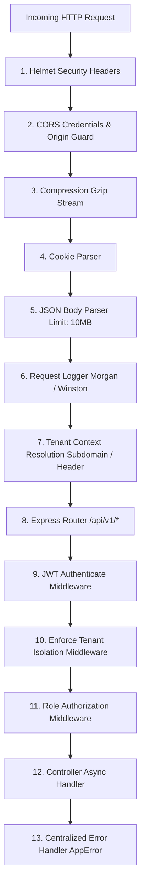

# DocuStudio SaaS — API & Database Architecture Audit (Phase 15)

**Audited By:** Principal SaaS Architect & Database Engineer  
**Audit Scope:** REST API endpoints, routing architecture, middleware chain, Mongoose schemas, compound indexes, constraints, multi-tenant boundaries, and BSON memory limits.

---

## 1. REST API Routing & Middleware Architecture

Every incoming HTTP request traverses a standardized pipeline in `backend/src/app.ts`:

---

## 2. Complete REST API Endpoints Inventory

| Method | Endpoint | Auth Required | Authorized Roles | Request Validation | Status |
| :--- | :--- | :---: | :---: | :---: | :---: |
| `GET` | `/api/v1/health` | No | Public | None | **Operational** |
| `POST` | `/api/v1/auth/register-shop` | No | Public | Zod `registerShopSchema` | **Operational** |
| `POST` | `/api/v1/auth/login` | No | Public | Zod `loginSchema` | **Operational** |
| `POST` | `/api/v1/auth/refresh` | No | Public | Body `refreshToken` | **Operational** |
| `POST` | `/api/v1/auth/logout` | No | Public | Body `refreshToken` | **Operational** |
| `POST` | `/api/v1/auth/forgot-password` | No | Public | Body `email` | **Operational** |
| `POST` | `/api/v1/auth/reset-password` | No | Public | Body `token`, `newPassword` | **Operational** |
| `GET` | `/api/v1/auth/me` | **Yes** | All Authenticated | JWT Token | **Operational** |
| `GET` | `/api/v1/dashboard/metrics` | **Yes** | All Staff | None | **Operational** |
| `POST` | `/api/v1/dashboard/seed-demo` | **Yes** | Owner / Manager | None | **Operational** |
| `GET` | `/api/v1/tenants/me` | **Yes** | All Staff | None | **Operational** |
| `PUT` | `/api/v1/tenants/me` | **Yes** | Owner / Manager | Body updates | **Operational** |
| `GET` | `/api/v1/tenants/staff` | **Yes** | Owner / Manager | Query filters | **Operational** |
| `POST` | `/api/v1/tenants/staff` | **Yes** | Owner / Manager | Body `fullName, email, role` | **Operational** |
| `PUT` | `/api/v1/tenants/staff/:id` | **Yes** | Owner / Manager | Body `role, phone, isActive` | **Operational** |
| `PATCH`| `/api/v1/tenants/staff/:id/status`| **Yes** | Owner / Manager | None | **Operational** |
| `GET` | `/api/v1/customers` | **Yes** | All Staff | Query `search, page, limit` | **Operational** |
| `POST` | `/api/v1/customers` | **Yes** | All Staff | Body `fullName, phone` | **Operational** |
| `GET` | `/api/v1/customers/:id` | **Yes** | All Staff | URL ObjectId | **Operational** |
| `PUT` | `/api/v1/customers/:id` | **Yes** | All Staff | Body updates | **Operational** |
| `DELETE`| `/api/v1/customers/:id` | **Yes** | Owner / Manager | URL ObjectId | **Operational** |
| `POST` | `/api/v1/customers/:id/files` | **Yes** | All Staff | Body `fileId, url, name` | **Operational** |
| `GET` | `/api/v1/customers/:id/files` | **Yes** | All Staff | URL ObjectId | **Operational** |
| `GET` | `/api/v1/jobs` | **Yes** | All Staff | Query `status, search, page` | **Operational** |
| `POST` | `/api/v1/jobs` | **Yes** | All Staff | Body `customerName, phone` | **Operational** |
| `GET` | `/api/v1/jobs/:jobId` | **Yes** | All Staff | URL ObjectId | **Operational** |
| `PATCH`| `/api/v1/jobs/:jobId/status` | **Yes** | All Staff | Body `status, note` | **Operational** |
| `POST` | `/api/v1/jobs/:jobId/files` | **Yes** | All Staff | Body `fileId, url, version` | **Operational** |
| `POST` | `/api/v1/jobs/:jobId/duplicate` | **Yes** | All Staff | URL ObjectId | **Operational** |
| `GET` | `/api/v1/passport/presets` | **Yes** | All Staff | None | **Operational** |
| `POST` | `/api/v1/passport/process` | **Yes** | All Staff | Body `imageBase64, presetId` | **Operational** |
| `POST` | `/api/v1/passport/sheet` | **Yes** | All Staff | Body `singlePhotoBase64` | **Operational** |
| `POST` | `/api/v1/passport/export-pdf` | **Yes** | All Staff | Body `sheetBase64, layout` | **Operational** |
| `POST` | `/api/v1/passport/jobs` | **Yes** | All Staff | Body job parameters | **Operational** |
| `GET` | `/api/v1/passport/jobs` | **Yes** | All Staff | None | **Operational** |
| `POST` | `/api/v1/document/process-page` | **Yes** | All Staff | Body `imageBase64, filterMode`| **Operational** |
| `POST` | `/api/v1/document/compose-a4` | **Yes** | All Staff | Body `pageBase64, pageSize` | **Operational** |
| `POST` | `/api/v1/document/export-pdf` | **Yes** | All Staff | Body `pages[]` | **Operational** |
| `POST` | `/api/v1/document/jobs` | **Yes** | All Staff | Body job parameters | **Operational** |
| `GET` | `/api/v1/idcard/presets` | **Yes** | All Staff | None | **Operational** |
| `POST` | `/api/v1/idcard/process-side` | **Yes** | All Staff | Body `sideBase64, cardType` | **Operational** |
| `POST` | `/api/v1/idcard/compose-sheet` | **Yes** | All Staff | Body `frontBase64, backBase64`| **Operational** |
| `POST` | `/api/v1/idcard/export-pdf` | **Yes** | All Staff | Body `sheetBase64` | **Operational** |
| `GET` | `/api/v1/cv/templates` | **Yes** | All Staff | Query `category, language` | **Operational** |
| `POST` | `/api/v1/cv/render-document` | **Yes** | All Staff | Body `templateId, variables` | **Operational** |
| `POST` | `/api/v1/cv/export-doc-pdf` | **Yes** | All Staff | Body `renderedContent` | **Operational** |
| `POST` | `/api/v1/cv/export-pdf` | **Yes** | All Staff | Body `cvData` | **Operational** |
| `POST` | `/api/v1/ocr/preprocess` | **Yes** | All Staff | Body `imageBase64, options` | **Operational** |
| `POST` | `/api/v1/ocr/extract` | **Yes** | All Staff | Body `imageBase64, language` | **Operational** |
| `POST` | `/api/v1/ocr/export-docx` | **Yes** | All Staff | Body `textBlocks, title` | **Operational** |
| `POST` | `/api/v1/ocr/export-pdf` | **Yes** | All Staff | Body `textBlocks, title` | **Operational** |
| `GET` | `/api/v1/printers` | **Yes** | All Staff | None | **Operational** |
| `GET` | `/api/v1/printers/queue` | **Yes** | All Staff | Query filters | **Operational** |
| `POST` | `/api/v1/printers/queue` | **Yes** | All Staff | Body print job payload | **Operational** |
| `PUT` | `/api/v1/printers/queue/reorder` | **Yes** | All Staff | Body `orderedJobIds[]` | **Operational** |
| `PATCH`| `/api/v1/printers/queue/:id` | **Yes** | All Staff | Body settings updates | **Operational** |
| `POST` | `/api/v1/printers/queue/:id/start`| **Yes** | All Staff | URL ObjectId | **Operational** |
| `POST` | `/api/v1/printers/queue/:id/complete`| **Yes**| All Staff | URL ObjectId | **Operational** |
| `DELETE`| `/api/v1/printers/queue/:id` | **Yes** | All Staff | URL ObjectId | **Operational** |
| `GET` | `/api/v1/printers/history` | **Yes** | All Staff | Query filters | **Operational** |
| `GET` | `/api/v1/subscription/plans` | **Yes** | All Authenticated | None | **Operational** |
| `GET` | `/api/v1/subscription/status` | **Yes** | All Authenticated | None | **Operational** |
| `POST` | `/api/v1/subscription/checkout` | **Yes** | Owner / Manager | Body `planKey, provider` | **Operational** |
| `POST` | `/api/v1/subscription/verify` | **Yes** | Owner / Manager | Body `transactionCode, sig` | **Operational** |
| `GET` | `/api/v1/subscription/history` | **Yes** | Owner / Manager | None | **Operational** |
| `GET` | `/api/v1/subscription/invoices/:id/pdf`| **Yes**| Owner / Manager | URL ObjectId | **Operational** |
| `GET` | `/api/v1/superadmin/dashboard` | **Yes** | Super Admin Only | None | **Operational** |
| `GET` | `/api/v1/superadmin/shops` | **Yes** | Super Admin Only | Query `search, status, plan` | **Operational** |
| `GET` | `/api/v1/superadmin/shops/:id` | **Yes** | Super Admin Only | URL ObjectId | **Operational** |
| `POST` | `/api/v1/superadmin/shops/:id/suspend`| **Yes**| Super Admin Only | Body `reason` | **Operational** |
| `POST` | `/api/v1/superadmin/shops/:id/activate`| **Yes**| Super Admin Only | None | **Operational** |
| `PUT` | `/api/v1/superadmin/shops/:id/subscription`| **Yes**| Super Admin Only| Body `planKey, status` | **Operational** |
| `GET` | `/api/v1/superadmin/plans` | **Yes** | Super Admin Only | None | **Operational** |
| `POST` | `/api/v1/superadmin/plans` | **Yes** | Super Admin Only | Body plan parameters | **Operational** |
| `PUT` | `/api/v1/superadmin/plans/:planKey`| **Yes**| Super Admin Only | Body updates | **Operational** |
| `DELETE`| `/api/v1/superadmin/plans/:planKey`| **Yes**| Super Admin Only | URL param | **Operational** |
| `GET` | `/api/v1/superadmin/transactions`| **Yes** | Super Admin Only | Query `status, page` | **Operational** |
| `GET` | `/api/v1/superadmin/invoices` | **Yes** | Super Admin Only | Query `page, limit` | **Operational** |
| `GET` | `/api/v1/superadmin/settings` | **Yes** | Super Admin Only | Query `category` | **Operational** |
| `PUT` | `/api/v1/superadmin/settings/:key`| **Yes** | Super Admin Only | Body `value` | **Operational** |
| `POST` | `/api/v1/superadmin/settings/bulk`| **Yes** | Super Admin Only | Body `settings[]` | **Operational** |
| `GET` | `/api/v1/superadmin/audit-logs`| **Yes** | Super Admin Only | Query `action, fromDate` | **Operational** |

---

## 3. Database Schema, Relations & Indexing Audit

### Compound Indexes Matrix:

| Collection / Model | Index Specification | Purpose & Performance Impact |
| :--- | :--- | :--- |
| **`User`** | `{ tenantId: 1, email: 1 }` (unique) | Ensures email uniqueness within tenant scope. O(log N) login lookup. |
| **`Tenant`** | `{ businessId: 1 }` (unique) | Unique studio identifier lookup (`SHOP-XXXXXX`). |
| **`Tenant`** | `{ subdomain: 1 }` (unique) | Fast tenant resolution from subdomain. |
| **`Job`** | `{ tenantId: 1, createdAt: -1 }` | Fast sorting for recent queue orders. Prevents table scans. |
| **`Job`** | `{ tenantId: 1, status: 1 }` | Fast filtering on Kanban status tabs (New, Processing, Printing). |
| **`Job`** | `{ tenantId: 1, customerId: 1, createdAt: -1 }` | Instant customer order history lookup. |
| **`Customer`** | `{ tenantId: 1, phone: 1 }` | Fast customer search by mobile phone. |
| **`Customer`** | `{ tenantId: 1, isDeleted: 1, createdAt: -1 }` | Excludes soft-deleted records from active directory queries. |
| **`PrintJob`** | `{ tenantId: 1, status: 1, queuePosition: 1 }` | High-speed print queue sequencing. |
| **`PaymentTransaction`**| `{ tenantId: 1, createdAt: -1 }` | Fast shop billing history retrieval. |
| **`PaymentTransaction`**| `{ idempotencyKey: 1 }` (unique) | Guards against duplicate credit card / wallet charges. |
| **`RefreshToken`** | `{ expiresAt: 1 }` (`{ expires: 0 }`) | **MongoDB TTL Index:** Automates physical document deletion upon expiry. |
| **`AuditLog`** | `{ tenantId: 1, timestamp: -1 }` | Multi-tenant security audit trail queries. |

### Database Gaps & Vulnerabilities Identified:

1. **Job Code Concurrency Collision Risk:**
   - In `Job.model.ts`, `jobCode` is indexed non-uniquely (`index: true`).
   - In `job.controller.ts`, job codes are generated via `JOB-${Date.now().toString().slice(-4)}${randomSuffix}`.
   - Under concurrent counter orders, duplicate job codes can be inserted into MongoDB without triggering a unique constraint error.
   - **Recommended Correction:** Add compound unique index `{ tenantId: 1, jobCode: 1 }` with `{ unique: true }`.

2. **Customer Phone Duplicate Constraint Missing at DB Level:**
   - In `Customer.model.ts`, `{ tenantId: 1, phone: 1 }` is **not** declared `unique: true`.
   - While `customer.controller.ts` checks `Customer.findOne()`, concurrent requests can race and insert duplicate customer records for the same phone number.
   - **Recommended Correction:** Add partial unique index `{ tenantId: 1, phone: 1 }` where `{ isDeleted: false }`.

3. **Multi-Megabyte Base64 Raster Storage in MongoDB (BSON Bloat):**
   - High-resolution 300 DPI A4 print sheets (2480 x 3508 px) are stored as Base64 strings inside `PassportJob`, `DocumentJob`, and `IdCardJob` documents.
   - A single document can reach 4MB to 10MB.
   - Storing image binaries directly in MongoDB documents degrades query performance, inflates memory consumption, slows down database backups, and risks triggering MongoDB's hard 16MB document limit.
   - **Recommended Correction:** Transition to local disk or S3/MinIO/Cloudflare R2 object storage with file path references.

