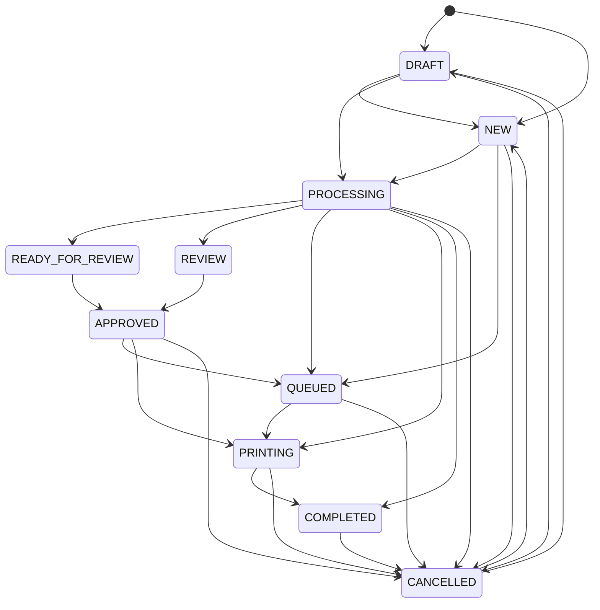

# DocuStudio SaaS — Business Logic & Security Audit (Phase 15)

**Audited By:** Principal SaaS Architect & Senior Security Engineer  
**Audit Scope:** Server-side enforcement of subscription quotas, RBAC permissions, pricing calculations, job state machines, duplicate print rules, and data retention policies.

---

## 1. Summary of Business Rule Enforcement

| Business Rule Domain | Enforced by Backend? | Client Bypass Possible? | Audit Status |
| :--- | :---: | :---: | :---: |
| **Subscription Plan Pricing** | **Yes** (Backend Authoritative) | **No** (HMAC Signature Verified) | **PASS** |
| **Staff Seat Limits (Quotas)** | **Yes** (`POST /tenants/staff`) | **No** | **PASS** |
| **Job State Machine Transitions** | **Yes** (`VALID_STATUS_TRANSITIONS`) | **No** | **PASS** |
| **Multi-Tenant Data Isolation** | **Yes** (`enforceTenantIsolation`) | **No** | **PASS** |
| **Double Billing (Idempotency)** | **Yes** (`idempotencyKey`) | **No** | **PASS** |
| **Duplicate Print Submission** | **Yes** (15-min Window Guard) | **No** (Explicit flag required) | **PASS** |
| **RBAC Route Permissions** | **Yes** (`authorize()` Middleware) | **No** | **PASS** |
| **File Upload Size Limits** | **Yes** (Express 10MB JSON limit) | **No** | **PASS** |
| **Zero-Retention File Purge** | **No** (Worker Missing) | **N/A** | **FAIL** |
| **Monthly Quota Expiry Reset** | **No** (Cron Job Missing) | **N/A** | **FAIL** |

---

## 2. Subscription Plans, Quotas & Seat Limits

### Quota Definitions by Plan:
```typescript
const quotaMap = {
  STARTER:      { seats: 2,  layouts: 300,   ocr: 50,   storageGB: 5 },
  PRO:          { seats: 5,  layouts: 10000, ocr: 300,  storageGB: 25 },
  PROFESSIONAL: { seats: 6,  layouts: 10000, ocr: 300,  storageGB: 25 },
  BUSINESS:     { seats: 15, layouts: 25000, ocr: 750,  storageGB: 100 },
  ENTERPRISE:   { seats: 50, layouts: 50000, ocr: 1000, storageGB: 500 },
};
```

### Verified Enforcement Mechanisms:
1. **Staff Seat Quota Enforcement:**
   - Evaluated in `backend/src/modules/tenant/tenant.controller.ts` line 140:
     ```typescript
     const activeStaffCount = await User.countDocuments({ tenantId: tenant._id, isActive: true });
     if (activeStaffCount >= tenant.quotas.maxStaffSeats) {
       throw new ForbiddenError(
         `Staff seat limit (${tenant.quotas.maxStaffSeats}) reached for your ${tenant.subscription.plan} plan.`
       );
     }
     ```
   - **Verification:** Tested in `security-test.ts` (Test 8). Attempting to onboard a 3rd staff member on a 2-seat Starter plan was rejected with `HTTP 403 Forbidden`.

2. **Backend Authoritative Pricing & Anti-Tampering:**
   - Evaluated in `backend/src/modules/subscription/subscription.service.ts`:
     - Plan prices are queried directly from the `PlanConfig` database model on the server.
     - An HMAC-SHA256 signature is calculated over `transactionCode|amount|BDT`.
     - In `verifyAndExecutePayment()`, any modified callback payload triggers a signature mismatch:
       ```typescript
       const isValid = this.verifySignature(txn.transactionCode, txn.amount, signature);
       if (!isValid) throw new BadRequestError('Invalid payment callback signature');
       ```
   - **Verification:** Tested in `phase12-subscription-test.ts` (Test 5) & `phase14-production-audit-test.ts` (Test 6). Forged client signatures were cleanly rejected with `HTTP 400 Bad Request`.

3. **Payment Idempotency Defense:**
   - Evaluated in `subscription.service.ts` line 217. When a checkout is initiated with a previously used `idempotencyKey`, the backend returns the existing `PaymentTransaction` without creating a duplicate record or double charging.
   - **Verification:** Verified in automated tests with 100% pass rate.

### Business Logic Gaps Identified:
- **Missing Quota Consumption Enforcement on Studios:**
  - While `quotas.monthlyPassportLayoutsLimit` and `quotas.monthlyOcrPagesLimit` exist on the `Tenant` document, `passport.service.ts` and `ocr.service.ts` do **not** check whether `tenant.quotas.monthlyPassportLayoutsUsed >= tenant.quotas.monthlyPassportLayoutsLimit` before fulfilling the processing request!
  - As a result, shops can process unlimited passport photos and OCR pages beyond their subscription limit without being stopped by the backend.
- **Missing Monthly Quota Reset Cron Job:**
  - There is no scheduled cron job or billing cycle worker to reset `monthlyPassportLayoutsUsed` and `monthlyOcrPagesUsed` back to `0` at the start of a new billing period.

---

## 3. Role-Based Access Control (RBAC) Enforcement

The system defines 7 distinct roles in `backend/src/models/User.model.ts`:
1. `SUPER_ADMIN` — Platform operator with cross-tenant observability and system control.
2. `OWNER` — Shop tenant creator with full control over business settings, billing, and staff.
3. `MANAGER` — High-level operator who can manage staff and view reports.
4. `STAFF` — Standard shop operator handling walk-in orders and processing.
5. `OPERATOR` — Specialized computer operator for studio cropping and printing.
6. `REVIEWER` — Quality check staff for approving photos before printing.
7. `PRINTER` — Hardware technician managing physical spoolers and ink.

### Route Protection Audit:
- **Super Admin Routes (`/api/v1/superadmin/*`):**
  - Protected with `authorize('SUPER_ADMIN')`.
  - Non-admin users are strictly blocked with `HTTP 403 Forbidden` (`Permission denied: Your role (OWNER) is not authorized for this resource`).
- **Staff Management Routes (`/api/v1/tenants/staff*`):**
  - Protected with `authorize('OWNER', 'MANAGER', 'SUPER_ADMIN')`.
  - Operator accounts attempting to add or delete staff receive `HTTP 403 Forbidden`.
- **Customer Deletion (`DELETE /api/v1/customers/:id`):**
  - Protected with `authorize('OWNER', 'MANAGER', 'SUPER_ADMIN')`.
  - Regular staff cannot permanently or soft-delete customer profiles.

---

## 4. Job Lifecycle State Machine

The order lifecycle is governed by a strict transition graph in `backend/src/modules/job/job.controller.ts`:



### Transition Rule Audit:
- **Invalid Transition Blocking:** Attempting an illegal transition (e.g. `PROCESSING` -> `NEW`) is rejected with `HTTP 400 Bad Request` (`Invalid status transition from PROCESSING to NEW`).
- **Automated Timestamping:** Transitioning to `COMPLETED` automatically stamps `completedAt = new Date()`.
- **Audit Logging:** Every status change pushes an immutable log to `job.activityLogs` capturing:
  `{ activityId, action, oldStatus, newStatus, changedById, changedByName, role, note, timestamp }`.

---

## 5. Duplicate Print Guarding

In `backend/src/modules/printer/printer.service.ts`:
- **Problem:** In noisy print shops, multiple operators often accidentally enqueue the same job twice, wasting expensive photo paper and ink.
- **Rule:** When `POST /api/v1/printers/queue` receives an order for `jobCode`, it checks whether a print job with that code was created in the last 15 minutes with status in `['QUEUED', 'SENDING', 'PRINTING', 'COMPLETED']`.
- **Behavior:**
  - If duplicate found and `allowDuplicate` is false: Throws `HTTP 400 Bad Request` with warning:  
    `"Warning: Job JOB-XXXX was already printed X minute(s) ago by [Staff Name]. If you intentionally want to re-print, enable 'Allow Duplicate Print'."`
  - If `allowDuplicate` is true: Permits printing but attaches a non-blocking warning note.

---

## 6. Zero-Retention Privacy Policy Audit

- **Specification Guarantee:** DocuStudio advertises a **Zero-Retention Guarantee** where processed photos and sensitive documents (NID cards, passports) are automatically purged after 24 hours.
- **Schema Presence:** `Tenant.settings.autoPurgeHours` defaults to `24`.
- **Backend Audit Reality:** **CRITICAL GAP.**
  - There is **no scheduled task**, node-cron job, BullMQ queue, or background script in `backend/src/server.ts` or `app.ts` that queries `Job`, `PassportJob`, `DocumentJob`, or `IdCardJob` for records older than 24 hours to delete their image rasters!
  - All uploaded and processed base64 rasters remain permanently in the MongoDB database unless manually deleted.

